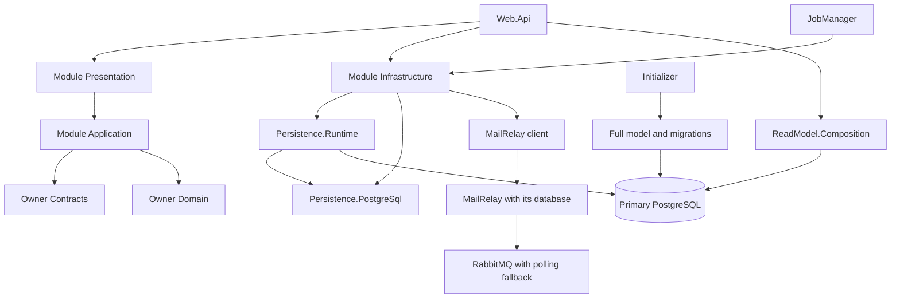

# Повторный анализ архитектуры backend FoodDiary

Период анализа: 22–23 октября 2026 года. Базовый commit: `da34fd3a85aad65b1aae11e0ce2c97c4612c1963`.
Проверяется рабочее дерево после исправлений. Посторонние изменения интерфейса,
существовавшие в общей рабочей копии, не относятся к этим исправлениям.

## Устройство и границы

FoodDiary остаётся модульным монолитом с общей PostgreSQL базой. HTTP принадлежит
Presentation, сценарии — Application, правила — Domain, адаптеры — Infrastructure.
Web.Api, JobManager и Initializer собирают зависимости. Owner Contracts публикуют
межмодульные возможности; Domain.Contracts содержат идентификаторы и значения.
Persistence.Runtime координирует общую транзакцию и module DbContexts,
ReadModel.Composition владеет составными SQL проекциями. Полная EF модель и миграции
принадлежат центральному Infrastructure.

MailRelay и MailInbox имеют отдельные хранилища и доступны основному backend через
разрешённые client packages. BugTriage также отделён от бизнес транзакций FoodDiary.
Полная карта владельцев: [BACKEND_MODULE_MAP](../BACKEND_MODULE_MAP.md).

## Исправления и повторная проверка

| Проблема | Итоговое поведение | Регрессия |
| --- | --- | --- |
| Initializer перекрывал окружение fallback JSON | JSON загружается раньше env; явный CLI аргумент остаётся последним; task config изолирован | `InitializerConfigurationTests` |
| RabbitMQ блокировал старт MailRelay | Bootstrap работает в фоне; HTTP и PostgreSQL polling запускаются без брокера | MailRelay hosted-service и PostgreSQL integration tests |
| API ждал здоровую почтовую инфраструктуру | Compose сохраняет зависимость от primary DB/Redis, почта запускается независимо | `HostAvailabilityBoundaryTests` |
| Reassignment пропускал дополнительные recipe/step images | Передаются все gallery assets и legacy covers с удалением дублей и проверкой владельца | `UserCleanupServiceIntegrationTests.RecipeGallery` |
| AI Reserve/Claim теряли первоначальный результат после успешного COMMIT с потерянным ACK | Независимая транзакция проверяет PostgreSQL outcome и возвращает исходный результат | `IndependentCommitOutcomeIntegrationTests` |
| Outbox claim оставлял сообщения под lease без dispatch | Подтверждённый COMMIT сохраняет исходный claim; callback не повторяется | Тот же PostgreSQL fault-injection набор с одной и двумя записями |
| JobManager не доставлял SignalR hint в API процесс | Видимый клиент согласует count и уже открытый feed каждые 30 секунд и при возвращении на вкладку | Notification reconciliation tests и браузерная проверка |
| Replay повторял уже завершённую административную операцию | Проверка COMMIT возвращает первоначальный audit, созданный один раз | `OutboxReplayBoundaryIntegrationTests` |
| В JobManager отсутствовал MealPlanning purge participant | Реальная worker composition подключает persistence; планы удаляются перед рецептами | `UserCleanupServiceIntegrationTests.JobManager` |
| Запоздалые notification requests пересекали смену аккаунта | HTTP результаты связаны с владельцем и поколением сессии; refresh/retry сохраняет владельца исходного запроса | Notification session и AuthInterceptor regressions |
| Ротация токена откладывала очередную сверку уведомлений | Таймер зависит от наличия токена; ротация в той же сессии сохраняет исходный deadline | Signal-based timer regression |
| Фоновая сверка заменяла открытую ленту spinner и пересоздавала DOM | Spinner используется при первоначальной загрузке; фоновая загрузка сохраняет карточки и фокус | NotificationsDialog DOM identity regression |
| После ошибки первого запроса открытая лента не повторяла загрузку | Намерение загрузить ленту сохраняется до смены сессии; очередная сверка повторяет запрос | First-load HTTP failure/recovery regression |
| Повторный вход того же пользователя во время остановки hub оставлял его отключённым | Новый connect ожидает общий stop; завершение очищает только прежнее соединение | Pending-stop same-user re-login regression |
| Чужие ссылки блокировали удаление аккаунта без получателя контента | По выбранной пользователем политике связанные рецепты, вложенные зависимости, продукты и их изображения переходят системному владельцу; несвязанный личный контент удаляется | `UserCleanupServiceIntegrationTests.SystemOwnership`, Users domain/application/provider и Admin metrics regressions |
| Новая ссылка между preflight и purge могла потеряться через Cascade/SetNull | Владельцы блокируют исходные строки перед повторным чтением; поздний preflight откладывает item; RecipeLikes получает недостающий FK | 15 gated PostgreSQL race/refusal cases и миграционная регрессия |

Общий verified COMMIT вынесен в `Shared/FoodDiary.Persistence.PostgreSql`. Библиотека
зависит только от EF relational storage и Npgsql; она не владеет DbContext, retry
policy, сохранением или callback. При подтверждённом abort сохраняется прежняя
ошибка; неизвестный outcome запрещает автоматический replay. Решение закреплено
в [ADR 0054](../adr/0054-independent-commit-verification-and-notification-reconciliation.md).

Повторный анализ охватывает физические `.csproj`, прямые XML ProjectReference,
транзитивные замыкания Contracts, граф owner API, runtime lifecycle ports,
композицию hosts, transaction/retry boundaries, outbox, purge, readiness и
жизненный цикл notification client. Условия MSBuild и imports не вычисляются
графовым скриптом; исполняемая матрица зависимостей дополнительно проверяется
архитектурными тестами. Отсутствие циклов проектов не означает независимость
данных или процессов.

В повторном объявленном графе: **458 проектов** — 299 production и 159 тестовых.
Backend без bot/tooling включает **295 проектов и 1673 прямые ссылки**. В 34 бизнес
модулях — 248 production проектов и 88 owner API связей. Циклов проектов и owner API,
нарушений направления слоёв и замыканий 58 Contracts проектов не обнаружено.
Runtime inventory содержит 26 портов; объединённый граф сохраняет 109 связей
и сильно связанную группу из 20 модулей. Это lifecycle/transaction coupling,
а не доказательство рекурсивного выполнения. Новые retention участники не добавляют
новых пар модулей: Users уже взаимодействовал с Recipes и Products при purge.

Исполняемая проверка исправленного дерева завершилась следующими результатами:

| Проверка | Фактический результат |
| --- | --- |
| Сборка всего `FoodDiary.slnx` | Успешно, 0 warnings / 0 errors |
| Backend unit, 159 TRX | 10 640 passed, 0 failed; 3 FFmpeg tests пропущены из-за отсутствия исполняемого FFmpeg |
| Архитектурные тесты, окончательный повтор | 2281 passed, 0 failed / skipped |
| Полный PostgreSQL infrastructure набор | 433 passed, 0 failed / skipped, включая гонки retention и COMMIT outcome |
| Полный Presentation набор | 355 passed, 0 failed / skipped |
| Полный Web.Api integration набор, окончательный повтор | 322 passed, 0 failed / skipped |
| Проверка форматирования solution | Успешно; миграционные файлы также проверены отдельно |
| NuGet, включая транзитивные зависимости | 458 проектов проверены, уязвимых пакетов и advisory rows не обнаружено |
| Notification / session regressions | 111 passed; четыре причинные регрессии воспроизведены на сохранённой прежней реализации |
| Chrome, фактическая доставка без SignalR | Новое unread уведомление доставлено через polling, старые DOM node и фокус сохранены; Escape возвращает фокус на trigger |

Первый общий API прогон выявил превышение бюджета monthly Meals: 1041,7 мс при
лимите 500 мс. Исходный тест отдельно прошёл до изменения кода. Performance
collection изолирована от параллельных integration collections; лимиты, сценарий,
объём данных и запросы не менялись. После этого весь API набор прошёл. Первые
ошибки архитектурного прогона исправлены точными allowlist обновлениями для новых
owner adapters и каноническим форматированием двух test projects.

В свежем Chrome сценарии SignalR заблокирован до входа. Между планированием
уведомления и следующим успешным polling запросом прошло около 5,6 секунды.
Ответ ленты дополнительно удерживался около 9,8 секунды: существующая карточка
оставалась в DOM и сохраняла фокус, spinner её не заменял. После освобождения
ответа лента содержала две карточки, unread count вырос с 1 до 2, прежняя запись
не изменилась. Подтверждена одна новая durable запись `FastingCompleted`; read и
read-all запросов не было. Оба собственных набора fixtures очищены. Этот сценарий
использует тестовый API scheduler и общий storage pipeline; реальная JobManager
composition проверена отдельно, доставка внешними providers здесь не заявляется.

Неизменяемые логи, TRX, hashes исходников и первоначальные неудачные прогоны
сохранены в `.artifacts/backend-architecture-fixes-20261022/`. Общий frontend gate
`npm run verify` и глобальная Wiki проверка координируются после заморозки общего
дерева; их итоговые receipts хранятся с общими QA результатами.

## Сохраняющиеся ограничения и принятые решения

Это ограничения действующей модели, а не обещание независимого развёртывания
модулей или exactly-once доставки.

- Общая схема, миграции, FK, snapshot reads и purge требуют согласованных релизов.
  Выделение модуля в сервис требует отдельного пересмотра этих контрактов.
- `Users` имеет высокий fan-in, преимущественно из-за стабильного `UserId`.
  Поведенческие Contracts следует расширять по связным owner capabilities.
- IQueryable read facade защищён анализаторами и архитектурными тестами. Новым
  потребителям нельзя приобретать через него права записи чужих агрегатов.
- SMTP и WebPush остаются at least once при сбое между приёмом провайдером и
  локальным checkpoint. Polling уведомлений обеспечивает актуальность через
  30 секунд плюс время успешного HTTP запроса; недоступная сеть эту границу отменяет.
- Independent Npgsql сервисы не повторяют callback через EF execution strategy.
  Они используют собственные idempotency keys, attempt fencing, lease expiry и
  reconciliation. Потеря ACK может дать ошибку клиенту или задержку до expiry;
  общей гарантии прозрачного восстановления каждого ответа нет.
- Системное владение сохраняет явно используемый чужими данными контент и
  замыкание его зависимостей, включая исторически приватные записи без смены
  видимости. Исходные аккаунт, credentials и несвязанный личный контент удаляются.
  Автоматическое удаление системного каталога после исчезновения последнего
  потребителя не добавлено. Постоянная техническая запись может оставаться пустой
  после отката очистки контента; она не является доступным для входа аккаунтом.
  Строгая очистка локальных owned fixtures сохраняет отказ от переноса данных.
- Большое число проектов увеличивает стоимость сборки и навигации. Массовое
  объединение слоёв требует измерений; fan-out composition roots сам по себе
  не нарушает архитектуру.

## Гарантии повторов и готовности

| Возможность | Действующая гарантия |
| --- | --- |
| CreateMeal / RepeatMeal с HTTP idempotency identity | Durable receipt сохраняется вместе с бизнес записью; Redis содержит lease/cache |
| CreateMealFromRecognition | Owner receipt привязан к пользователю и recognition ID |
| Другие endpoints с `EnableIdempotency` | HTTP lease/cache не является durable бизнес receipt; нельзя обобщать гарантию Meals на остальные операции |
| AI quota и recognition claim | Независимые короткие транзакции, исходный результат сохраняется после подтверждённого COMMIT |
| Generic outbox / administrative replay | Verified COMMIT защищает локальное решение; удалённая доставка сохраняет собственную at-least-once семантику |
| API readiness | Требует PostgreSQL, distributed cache и S3; сбой S3 может блокировать rollout и readiness, хотя уже работающие функции без изображений могут продолжать работу |
| MailRelay readiness | Требует его PostgreSQL; RabbitMQ не является обязательным условием HTTP/polling |

Расширять durable receipts следует по конкретному owner контракту и отказному
сценарию; автоматическое добавление ко всем командам изменило бы их семантику.
Изменение API readiness на режим частичной доступности также требует отдельного
решения о маршрутизации и гарантиях image flows.

## Пределы анализа

Проверка исходников и управляемых отказов не доказывает отсутствие всех будущих
ошибок. Production поведение, частота инцидентов, реальная нагрузка, восстановление
из резервных копий и внешние provider SLA в этом проходе не измерялись. Deployment
и изменения production данных не выполнялись.

## Полный owner API граф

A → B означает потребление опубликованных возможностей B из Application A. Скаляры ID и runtime-порты в эту таблицу не входят.

| Модуль | Production проекты | Зависит от owner API |
| --- | ---: | --- |
| Admin | 7 | Ai, BodyMetrics, ContentReports, DailyAdvices, Gamification, Identity, Lessons, Users |
| Ai | 7 | Images, Users |
| Billing | 8 | Marketing, Users |
| BodyMetrics | 9 | Users |
| ContentReports | 8 | Users |
| Cycles | 10 | Meals, Users |
| DailyAdvices | 6 | Users |
| Dashboard | 6 | BodyMetrics, Cycles, DailyAdvices, Dietologist, Exercises, Fasting, Hydration, Identity, Meals, Tdee, Users |
| Dietologist | 8 | Identity, Notifications, Users |
| Exercises | 7 | Users |
| Export | 4 | Cycles, Meals, Users |
| Fasting | 9 | Notifications, Users |
| Favorites | 10 | Users |
| Gamification | 8 | Meals, Users |
| Hydration | 9 | Users |
| Identity | 7 | Notifications, Users |
| Images | 8 | Users |
| Lessons | 8 | Gamification, Users |
| Marketing | 7 | — |
| MealPlanning | 6 | Products, Users |
| Meals | 11 | Ai, Favorites, Images, Products, RecentItems, Recipes, Usda, Users |
| Notifications | 9 | Users |
| OpenFoodFacts | 7 | — |
| Products | 9 | Favorites, Images, OpenFoodFacts, RecentItems, Usda, Users |
| RecentItems | 6 | — |
| RecipeCommunity | 7 | Notifications, Recipes, Users |
| Recipes | 8 | Favorites, Images, Products, RecentItems, Users |
| Statistics | 2 | BodyMetrics, Hydration, Meals, Users |
| Tdee | 5 | BodyMetrics, Exercises, Meals, Users |
| Usda | 7 | Users |
| Users | 10 | — |
| Wearables | 6 | Users |
| WeeklyCheckIn | 2 | BodyMetrics, Hydration, Meals, Users |
| WeeklyGoals | 7 | Meals, Notifications, Users |
